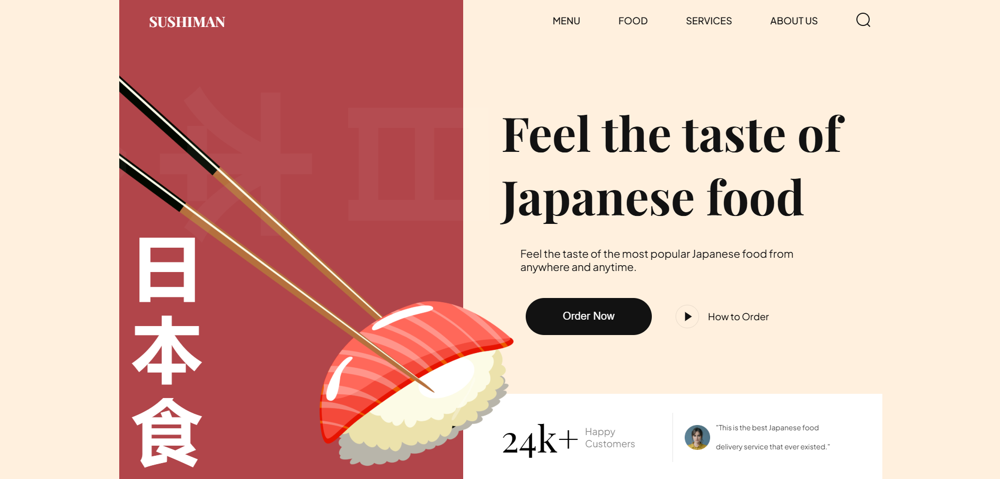

# Sushiman Webpage

A modern, responsive landing page for a Japanese food delivery service, built with HTML, CSS and Vite



## Features

- Responsive design for desktop and mobile
- Animated scroll effects using [AOS](https://michalsnik.github.io/aos/)
- Modern CSS with custom variables and modular section styles
- Mobile navigation menu toggle and food category filtering
- Newsletter signup layout
- Clean, accessible markup and semantic structure

## Tech Stack

- **HTML5**
- **CSS3** (with modular section files)
- **JavaScript** (ES Modules)
- **Vite** (development server & build tool)
- **AOS** (Animate On Scroll library)


## Project Structure
```
.
├── assets/        # Images and SVGs
├── css/           # CSS files (modular by section)
├── js/            # JavaScript files
├── public/        # Static assets (if needed)
├── index.html     # Main HTML file
└── package.json   # Project metadata
```

## Getting Started

1. **Install dependencies:**
```sh
npm install
```

2. **Start the development server:**
```sh
npm run dev
```

3. **Build for production:**
```sh
npm run build
```

**This project was created by following a tutorial from the [JavaScript Mastery](https://www.youtube.com/@javascriptmastery) YouTube channel.**